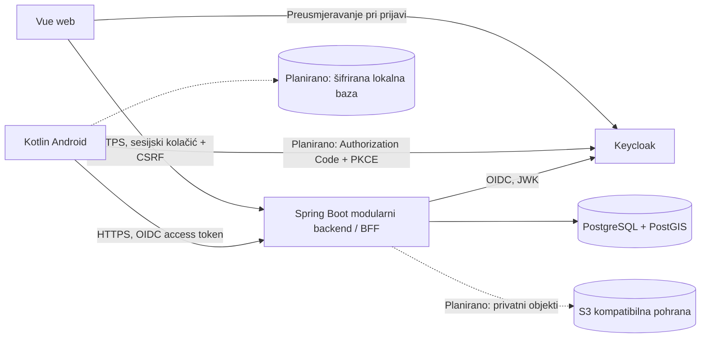

# Arhitektura projekta

Status: početna implementacijska osnova, 23.11.2026.

Poslovni obuhvat definira [specifikacija prve operativne verzije](Specifikacija_prve_operativne_verzije.md). Ovaj dokument opisuje tehničke granice sistema i razlikuje postojeći kod od sljedećih koraka.

## Komponente



Jedan backend proces obuhvata sve domenske module. Jedna PostgreSQL baza ima odvojene šeme modula; Keycloak koristi zasebnu bazu i račun. Vue se u produkciji posluži iza istog HTTPS origin-a kao web API. Android koristi zasebne bearer-token rute.

S3 i šifrirana mobilna pohrana prikazuju ciljnu arhitekturu; adapteri još nisu implementirani.

## Tehnološka osnova

| Dio | Odabir |
| --- | --- |
| Backend | Java 21; Spring Boot 4.1.0; Spring Modulith 2.1.0 |
| Podaci | PostgreSQL 17 / PostGIS 3.5; Flyway; JDBC |
| Web | Vue 3.5; TypeScript 5.9; Vite 8.3 |
| Identitet | Keycloak 26.7, OIDC |
| Android | Kotlin 2.1.21; Compose; AGP 8.9.2; Gradle 8.11.1; min SDK 28, target/compile SDK 35 |
| Automatizacija | GitHub Actions; odvojene provjere backenda, weba i Androida |

Tačne verzije su u Maven/Gradle konfiguraciji, `frontend/package-lock.json` i Compose fajlu. Nadogradnje idu kroz zasebne izmjene s provjerama kompatibilnosti.

## Domenski moduli

| Modul / šema | Vlasništvo nad podacima i pravilima |
| --- | --- |
| `access` | Organizacije, korisnički pristup, teritorijalna ovlaštenja i veze na OIDC identitete |
| `people` | Jedinstvena osoba i pravila povezivanja/duplikata |
| `membership` | Članstvo osobe u organizaciji i sezoni |
| `waters` | Ribolovna područja, vode, prostorne granice i režimi |
| `billing` | Uplate, raspodjele, ispravke i finansijske reference |
| `permits` | Vrste, izdavanje, važenje i poništavanje dozvola |
| `fieldwork` | Terenske kontrole, offline paketi i prijem sinhronizacije |
| `reporting` | Izvještajni upiti i projekcije s ograničenjem pristupa |
| `documents` | Metapodaci priloga i pristup privatnim objektima |
| `notifications` | Asinhrona obavještenja i pokušaji dostave |
| `audit` | Evidencija poslovnih i sigurnosnih promjena |

Trenutno su deklarisane granice svih 11 modula i njihove šeme. `access` sadrži početnu autentikaciju. Ostali moduli još nemaju poslovne servise, tabele ili ekrane.

Svaki modul ima izloženi paket `api`. Pri dodavanju funkcionalnosti struktura je:

```text
ba.ribolov.<modul>
├── api/                  javni ugovori, komande, rezultati i događaji
└── internal/
    ├── application/      slučajevi upotrebe i transakcije
    ├── domain/           poslovna pravila
    ├── infrastructure/   JDBC, vanjski servisi i pohrana
    └── web/              HTTP adapteri
```

Prazne slojeve ne dodajemo unaprijed. Postojeći mali sigurnosni adapteri nalaze se neposredno u `access.internal`; razdvajanje slijedi kada se uvedu poslovni slučajevi.

Pravila razvoja:

1. Modul pristupa drugom modulu preko njegovog `api` ugovora. Ne koristi tuđi repozitorij, internu klasu ili SQL tabelu za upis.
2. Svaka nova zavisnost eksplicitno se dodaje u `@ApplicationModule(allowedDependencies = ...)`, npr. `people :: api`. Početno nema dozvoljenih međumodulskih zavisnosti.
3. Transakciju započinje aplikacijski slučaj upotrebe. U istoj bazi dozvoljeno je pozvati drugi javni ugovor u istoj transakciji kada poslovni invariant to traži.
4. Slanje poruka, izrada dokumenata i obavještavanje idu poslije potvrde transakcije preko trajnog outbox-a. Outbox još nije implementiran.
5. Arhitektonski test provjerava postojanje svih modula, cikluse i neovlaštene zavisnosti. Novi poslovni slučaj dobija test koji provjerava njegovo pravilo, a ne samo strukturu metoda.

## Identitet i pristup

Keycloak upravlja prijavom, lozinkama i budućom MFA politikom. Backend će upravljati poslovnim ovlaštenjima, organizacijom i teritorijalnim opsegom. OIDC identitet se trajno povezuje preko para `issuer + subject`; email ili prikazano ime nisu identifikatori ovlaštenja.

Postoje dva odvojena sigurnosna lanca:

- Web `/api/v1/**`: backend je OIDC klijent; preglednik dobija HttpOnly sesijski kolačić, bez pohrane access/refresh tokena u JavaScriptu. Mutacije zahtijevaju CSRF token. Prijava počinje na `/oauth2/authorization/keycloak`, a odjava je POST `/logout` uz CSRF.
- Android `/api/mobile/**`: stateless bearer autentikacija; provjeravaju se potpis, issuer, vrijeme važenja i audience `ribolov-api`. CSRF je isključen samo za ovaj lanac. Klijent je public s obaveznim PKCE S256; mobilni login još nije povezan.

Dostupni su samo identitet sesije, CSRF token i zdravstvene provjere. Ostale poslovne rute imaju `denyAll` dok se ne uvedu ovlaštenja. Prijavljen korisnik ne dobija automatski pravo pristupa članovima ili dozvolama.

Web sesije su trenutno u memoriji jednog procesa. Prije više backend instanci potreban je zajednički session store, npr. Spring Session JDBC, uz definisanu politiku opoziva. MFA za privilegovane korisnike još treba podesiti u Keycloaku.

## Baza i migracije

`platform` sadrži Flyway historiju, a domenske šeme odgovaraju modulima. Runtime račun `ribolov_app` nema vlasništvo nad šemama, CREATE, superuser ili BYPASSRLS. Migracije koriste zaseban račun. U lokalnom Compose okruženju bootstrap/migration račun `ribolov_owner` ima administratorska prava radi inicijalizacije; produkcijski bootstrap i migrator moraju se razdvojiti.

Prva migracija kreira šeme i dodjeljuje runtime računu prava za buduće tabele/sekvence. Integracijski test na stvarnom PostgreSQL-u provjerava ponovljeno pokretanje migracija, šeme i zabranu DDL-a runtime računu.

Pri kreiranju prvih domenskih tabela uvode se:

- UUID identifikatori, vremenske oznake u UTC i eksplicitne poslovne vremenske zone.
- Globalna osoba, a članstvo odvojeno po organizaciji i sezoni.
- Provjera pristupa na aplikacijskom sloju te PostgreSQL RLS za podatke s organizacijskim/teritorijalnim opsegom.
- Transakcijski kontekst ovlaštenja kroz `SET LOCAL` ili ekvivalent, tako da ne ostane na pooled konekciji.
- Optimističko zaključavanje promjenjivih zapisa, jedinstveni indeksi i strani ključevi za ključne invariante.
- Iznosi kao decimalni novčani tipovi s valutom; bez floating-point računanja.

RLS nije implementiran jer domenske tabele još ne postoje. Ne smije se smatrati da odvojene šeme same pružaju izolaciju organizacija.

## Uplate, dozvole i događaji

Uplata i dozvola imaju različite životne cikluse. Evidentirana uplata nije izdata dozvola. Izdavanje zasebno provjerava članstvo, područje, ovlaštenje izdavaoca, raspoloživu uplatu i idempotency ključ.

Ponavljanje zahtjeva mora vratiti isti rezultat; djelimičan kvar ne smije proizvesti duple dozvole ili dvostruko trošenje iste uplate. Potrebni su transakcijski invariant, jedinstveni ključ i zaključavanje relevantnog salda/raspodjele. Korekcije ostavljaju trag; finansijski i audit podaci se ne prepisuju bez historije.

Trajna publikacija događaja/outbox uvodi se s prvim asinhronim slučajem. Retry obrada mora biti idempotentna, s brojem pokušaja i pregledom trajno neuspjelih poruka.

## Android i offline rad

Postoji Compose početni ekran, interfejsi za outbox/sinhronizaciju i čista Kotlin politika offline važenja. Android još ne prijavljuje korisnika, ne skenira QR kodove i ne sprema kontrole.

Početna politika prati prijedlog iz specifikacije:

| Uslov | Status |
| --- | --- |
| Nema sinhronizacije, nepouzdan sat ili negativno proteklo vrijeme | Potrebna sinhronizacija |
| Manje od 24 sata, ovlaštenje važi | Svježi podaci |
| Od 24 sata do isteka ovlaštenja, najviše 72 sata | Zastarjeli podaci |
| Ovlaštenje isteklo ili proteklo najmanje 72 sata | Offline pristup istekao |

Kraće teritorijalno ovlaštenje uvijek skraćuje period rada. Politika prima pouzdano proteklo trajanje; ne oslanja se direktno na korisnički podesiv sat. Adapter za monotono vrijeme, promjenu uređaja i restart tek slijedi.

Sljedeći koraci su šifrirana Room baza izolovana po nalogu/uređaju, ključevi u Android Keystore-u, registracija uređaja, potpisan offline paket i QR provjera. WorkManager šalje trajni outbox s UUID-om zahtjeva; server mora deduplicirati zahtjeve i primijeniti eksplicitna pravila konflikta. Dostupnost mreže sama ne znači uspješnu sinhronizaciju.

## API i operativni rad

Početni ugovor je u [OpenAPI dokumentu](api/openapi.yaml). Nove poslovne rute koriste verzionisani API, validirane ulaze i strukturisane greške; ne izlažu persistence objekte.

Actuator javno izlaže samo zdravstvene provjere bez detalja. Readiness treba proširiti bazom kada backend počne služiti domenske upite; liveness ostaje nezavisan od vanjskih servisa. Ne treba dodavati identifikacijske podatke, tokene ili sadržaj priloga u logove.

Prije produkcije slijede HTTPS i reverse proxy, produkcijska Keycloak konfiguracija/MFA, zaseban migrator, tajne iz odgovarajuće pohrane, ograničenja saobraćaja, backup i provjera povrata, nadzor, privatna objektna pohrana i testovi izolacije organizacija.

## Redoslijed razvoja

1. Organizacije, veza korisnika s identitetom i teritorijalna ovlaštenja; prve tabele/RLS i testovi izolacije.
2. Osobe i članstvo, uz kontrolu duplikata i audit.
3. Područja, vrste dozvola i pravila važenja.
4. Uplata → izdavanje → provjera dozvole, uz idempotenciju.
5. Registracija uređaja, offline paketi i sinhronizacija terenskih kontrola.
6. Izvještaji, dokumenti, obavještavanje i operativno očvršćavanje.

Svaki korak isporučuje funkcionalan tok kroz bazu, backend i odgovarajući klijent, uz testove poslovnih pravila i pristupa.
