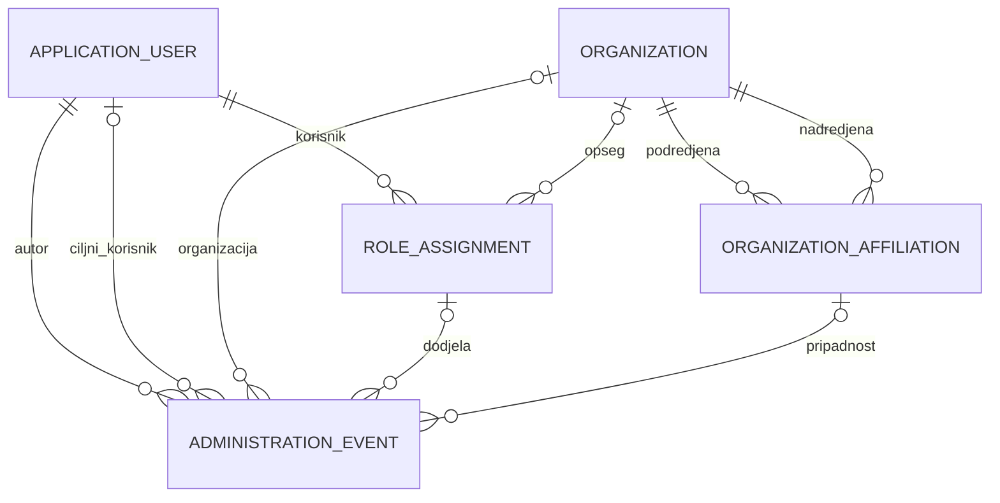

# Administracija organizacija i pristupa

Status: implementirani JPA model, administrativni API i web ekrani, 23.11.2026. Ovo je prva razvojna cjelina; kompletna operativna verzija iz specifikacije još nije završena.

## Model i granice modula

Veze su stvarne JPA relacije i strani ključevi. Entiteti nemaju paralelne skalarne reference niti kolonu `code`. UUID-i u API zahtjevima su DTO identifikatori koji se razrješavaju u entitete. Jedinstveni OIDC par issuer/subject predstavlja identitet u vanjskom sistemu.

Organizacije i historijske pripadnosti pripadaju modulu `organizations`. Modul `access` koristi `organizations :: model` za relacije, a `organizations :: api` za mutacije koje izvršava vlasnički modul. Administrativni audit pripada istom slučaju upotrebe u modulu `access`; time nema kružne zavisnosti prema budućem opštem modulu `audit`.

Sve mutacije i njihov audit izvršavaju se u istoj transakciji. Audit ima autora, vrijeme, radnju, razlog i relacije prema pogođenim zapisima. Runtime račun ga ne može mijenjati niti brisati. Ovo još nije opšti audit svih modula niti snimak starih i novih vrijednosti svakog polja; imena u pregledu razrješavaju se iz trenutnih povezanih zapisa.

`@Version` sprečava prepisivanje zastarjelih podataka. Hibernate ažurira samo promijenjene kolone, usklađeno s pravima runtime računa. Nema kaskadnog brisanja historije, a DTO nastaje unutar transakcije uz isključen `open-in-view`.

## Dostupne radnje

| Radnja | Administrator sistema | Administrator udruženja |
| --- | --- | --- |
| Pregled organizacija | Sve organizacije | Samo aktivno izabrano udruženje |
| Kreiranje organizacije | Ministarstvo, Savez, udruženje | Nije dostupno |
| Naziv i kontakti | Sve aktivne organizacije | Vlastito udruženje |
| Pripadnost i njena historija | Da | Nije dostupno |
| Pozivanje korisnika | Analitičar/administrator | Operater/ribočuvar svog udruženja |
| Ime i aktivnost lokalnog korisnika | Da, uz zaštitu sistemskih administratora | Nije dostupno |
| Pregled korisnika | Svi lokalni nalozi | Korisnici s dodjelom u izabranom udruženju |
| Poziv i opoziv uloge | Analitičar Ministarstva/Saveza, administrator udruženja | Operater i ribočuvar vlastitog udruženja |
| Historija administrativnih radnji | Sistemski pregled | Samo izabrano udruženje |

Sistemska uloga i uloga ribolovca nisu dostupne za dodjelu kroz ovaj API. Dodjela ribočuvara još ne daje teritorijalni pristup kontrolama ili dozvolama.

Svaki zahtjev bira tačno jednu vlastitu važeću dodjelu kroz `X-Access-Context`. Privilegije različitih uloga se ne sabiraju. Web pri promjeni konteksta uklanja prethodne podatke i obrazac. Aktivnost naloga, organizacije i dodjele provjerava se pri svakom zahtjevu.

Promjena pripadnosti zatvara prethodni period i kreira novu JPA vezu. Dopušteni su Savez → Ministarstvo i udruženje → Savez, s najviše jednim roditeljem u trenutku. Može početi odmah ili u budućnosti; retroaktivni upis i druga paralelna zakazana promjena se odbijaju. Tip organizacije se ne mijenja.

Prvi SYS nalog postavlja se kontrolisanim [bootstrap postupkom](Razvoj.md#prvi-administrator-i-mfa). Ostali nalozi i nove uloge nastaju kroz [jednokratne pozive](Pozivi_i_prijava.md), nakon potvrđene adrese i prihvatanja. Ručni unos OIDC subject-a i dodjela preko korisničkog UUID-a više nisu dostupni kroz HTTP/web.

## Sigurnost i migracije

- Web koristi serversku OIDC sesiju i CSRF token. Administracija nije izložena mobilnim bearer rutama.
- `acr=2` se čita iz verifikovanog ID tokena. Za upis je potreban `auth_time` najviše pet minuta star; korisnik inače dobija 403 i zahtjev za obnovu prijave. Browser ne može dostaviti te tvrdnje kroz poslovna zaglavlja.
- Keycloak razvojni realm ima tok lozinka + OTP i nivo autentikacije 2 za web. Promjena JSON-a ne mijenja ranije uvezeni realm; vidi razvojni vodič.
- Transakcijski PostgreSQL kontekst koristi `set_config(..., true)`. RLS nezavisno ograničava izabrano udruženje, dozvoljene uloge, MFA i svježinu prijave.
- Primalac poziva dobija pristup samo svom pozivu i potrebnim povezanim zapisima; ne otvara se globalna pretraga korisnika.
- V002 uvodi organizacije, korisnike, pripadnosti i dodjele, FK i exclusion ograničenja. V003 uvodi administrativni audit, ime za prikaz, uske write politike i prava ažuriranja pojedinih kolona. V004 dodaje pozive i njihove politike.
- Runtime `ribolov_app` nije vlasnik tabela niti ima `BYPASSRLS`. Migracije i jednokratni bootstrap koristi zaseban vlasnik.
- Odgovori su DTO objekti s `Cache-Control: no-store`. Zastarjele verzije i konflikt perioda daju 409; odbijeni upisi ne ponavljaju se automatski.

## API i web

[OpenAPI](api/openapi.yaml) opisuje session, CSRF, access-context i administrativne rute.

`/api/v1/admin` sadrži:
- `GET/POST /organizations`, `PUT /organizations/{id}`;
- `GET /organizations/{id}/history`, `POST /organizations/{id}/parent`;
- `GET /users`, `PUT /users/{id}`;
- `GET /roles`, `POST /roles/{id}/revoke`;
- `GET /events`;
- `GET/POST /invitations`, `POST /invitations/{id}/revoke` i `POST /invitations/{id}/retry`.

Primalac koristi `POST /api/v1/invitations/preview` i `POST /api/v1/invitations/accept`.

Sve liste imaju stranice od 50 zapisa, indeks od nule i `hasNext`; historija pripadnosti ima limit od 1000 zapisa. Organizacije i korisnici podržavaju pretragu naziva/imena. Svaki upis traži razlog. Vrijeme se prenosi kao UTC instant; obrazac jasno prikazuje lokalnu vremensku zonu uređaja.

Web prikazuje aktivnu ulogu, organizacije, korisnike, dodjele i historiju promjena. Obrasci podržavaju kreiranje, izmjenu, promjenu pripadnosti i opoziv; istovremeni upis zaključava izbor konteksta. Konflikt traži osvježavanje i ponovno otvaranje obrasca, a istek MFA vodi na ponovnu prijavu.

## Provjera i preostali posao

Prošlo je 54 backend testa: 37 bez PostgreSQL-a i 17 na stvarnom PostgreSQL-u 15.1. Pokriveni su mapiranje, hijerarhija, historija, verzije, transakcijski rollback audita, dozvoljene i zabranjene dodjele, MFA, CSRF i izolacija dva udruženja čak i kada isti korisnik ima administratorsku ulogu u oba. Jednokratni bootstrap je provjeren zajedno s odbijanjem ponovnog pokretanja.

TypeScript provjera i produkcijski web build prolaze. Browser test u `frontend/tests/admin-ui.mjs` koristi kontrolisane API odgovore za provjeru korisničkih tokova; nije zamjena za integraciju sa stvarnim backendom i Keycloakom. Detaljan rezultat lokalne provjere nalazi se u [razvojnom vodiču](Razvoj.md#zabiljezena-provjera).

Standardni Maven lifecycle nije potvrđen zbog ograničenja zatvaranja javac arhiva u sandboxu; kompilacija je prošla kroz Java Compiler API, a testovi kroz Surefire. CI koristi PostgreSQL 17. Stvarni Keycloak OIDC/OTP tok i Android build ostaju za potpuno razvojno/CI okruženje.

Naredne cjeline su teritorijalna ovlaštenja, arhiviranje uz provjeru obaveza te osobe i članstvo. Pozivni tok iz IAM-06 je implementiran; stvarnu Keycloak integraciju tek treba potvrditi u kompletnom okruženju. Opšti audit, dozvole, naplata i terenske kontrole još nisu završeni.
